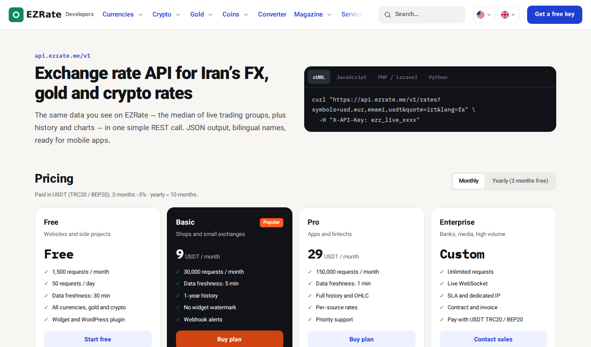

# Iran Exchange Rate, Gold & Coin Price API — EZRate

[](https://ezrate.me/api/en)
[](https://ezrate.me/auth/register/en)
[فارسی](README.md)

**EZRate** is a REST API for Iran's live free-market prices: **US dollar, euro, UAE dirham, Turkish lira and 20+ other currencies, 18k and 24k gold, mithqal, the world gold ounce, Emami and Bahar Azadi coins, USDT (Tether), Bitcoin and other crypto**. JSON responses in Toman, Rial, US dollars, USDT or any other asset you choose.

Prices are computed from real trades (exchange-shop channels, markets and crypto exchanges) using the median of many sources. Every rate carries its number of sources, so you know how much it can be trusted.

> 🔑 **Free key:** sign up at [ezrate.me](https://ezrate.me/auth/register/en) and create a key under Dashboard › API keys. Sign-up and the free plan cost nothing.



## Quick start

Base URL: `https://api.ezrate.me/v1`. Send your key in `X-API-Key` (or `Authorization: Bearer`).

```bash
curl -H "X-API-Key: ezr_live_YOUR_KEY" \
  "https://api.ezrate.me/v1/rates?symbols=usd,g18,emami,usdt&lang=en"
```

```json
{
  "data": [
    { "symbol": "usd", "code": "USD", "name": "US Dollar", "category": "fiat", "market": "tehran",
      "buy": 259150, "sell": 259350, "usd": null, "change_pct": 0.12,
      "sources": 13, "low_sources": false, "updated_at": "2026-10-13T21:35:00Z", "quote": "IRT" },
    { "symbol": "usdt", "code": "USDT", "name": "Tether", "category": "crypto",
      "buy": 257300, "sell": 257600, "usd": "1.00046606", "change_pct": 0.37, "sources": 16, "quote": "IRT" }
  ],
  "meta": { "as_of": "2026-10-14T11:07:42Z", "freshness_sec": 1800, "quote": "IRT" }
}
```

| Field | Meaning |
|---|---|
| `buy` / `sell` | buy and sell price in `quote` (Toman by default) |
| `change_pct` | 24-hour change, % |
| `usd` | price in US dollars (gold and crypto) |
| `sources` / `low_sources` | number of sources in the price, and a flag when they are few |
| `meta.freshness_sec` | data freshness of your plan |

## Currencies (USD/IRR and more)

```bash
curl -H "X-API-Key: $EZRATE_KEY" "https://api.ezrate.me/v1/rates?category=fiat&lang=en"
curl -H "X-API-Key: $EZRATE_KEY" "https://api.ezrate.me/v1/rates/usd"                  # with every market
curl -H "X-API-Key: $EZRATE_KEY" "https://api.ezrate.me/v1/rates?symbols=usd&quote=IRR"  # in Rial
```

Common symbols: `usd` `eur` `aed` `try` `gbp` `cny` `cad` `aud` `sar` `iqd` `afn` `rub` `jpy` — full list: `GET /v1/assets?category=fiat`.

## Gold and coin prices

```bash
curl -H "X-API-Key: $EZRATE_KEY" "https://api.ezrate.me/v1/rates?category=gold"
curl -H "X-API-Key: $EZRATE_KEY" "https://api.ezrate.me/v1/rates?symbols=g18,mesghal,ounce,emami,bahar"
```

Symbols: `g18` `g21` `g22` `g24` `mesghal` `ounce` · coins `emami` `bahar` `nim` `rob` `gerami` · metals `silver` `copper`.

## USDT and crypto in Toman

```bash
curl -H "X-API-Key: $EZRATE_KEY" "https://api.ezrate.me/v1/rates?symbols=usdt,btc,eth,ton,trx"
curl -H "X-API-Key: $EZRATE_KEY" "https://api.ezrate.me/v1/rates?category=crypto&quote=USDT"
```

## Conversion and cross rates

`quote` sets the unit of every price: `IRT` (Toman, default), `IRR` (Rial) or any asset symbol (`usd`, `usdt`, `eur`, `g18`…).

```bash
curl -H "X-API-Key: $EZRATE_KEY" "https://api.ezrate.me/v1/convert?from=usd&to=eur&amount=100"
curl -H "X-API-Key: $EZRATE_KEY" "https://api.ezrate.me/v1/cross?base=usd&symbols=eur,aed,irt"
```

## History (OHLC candles)

```bash
curl -H "X-API-Key: $EZRATE_KEY" "https://api.ezrate.me/v1/history/usd?interval=1d&from=2026-09-01&to=2026-10-01"
```

## Endpoints

| Endpoint | Use |
|---|---|
| `GET /v1/assets?category=fiat\|gold\|coin\|crypto` | assets and symbols |
| `GET /v1/rates?symbols=&category=&quote=&lang=` | live prices |
| `GET /v1/rates/{symbol}` | one asset in every market |
| `GET /v1/history/{symbol}?interval=1h\|1d&from=&to=` | history (candles) |
| `GET /v1/convert?from=&to=&amount=&side=buy\|sell\|mid` | conversion |
| `GET /v1/cross?base=&symbols=` | cross rates |
| `GET /v1/global?base=USD` | world exchange rates |
| `GET /v1/markets/{symbol}` | price in each market |
| `GET /v1/usage` | today's and this month's usage (free of quota) |

Full spec: [`openapi.yaml`](openapi.yaml) (open it in Postman or Swagger Editor).

## Code samples

[PHP](examples/php/rates.php) · [JavaScript / Node.js](examples/javascript/rates.mjs) · [Python](examples/python/rates.py) · [cURL](examples/curl.sh)

Keep the key in the `EZRATE_KEY` environment variable — never in browser code or a published app. To show prices on a website, use the [widgets](https://github.com/ezrate-me/ezrate-widgets): no key needed.

## Errors and limits

| Code | Meaning |
|---|---|
| `401 invalid_api_key` | missing, unknown or revoked key |
| `403 forbidden` | domain or IP not allowed by your key settings |
| `429 rate_limited` | daily or monthly quota used; reset time in `meta.reset_at` |

Quotas, freshness and history depth per plan: [API page](https://ezrate.me/api/en) and [plans](https://ezrate.me/plans/en).

## Widgets and WordPress

- **[Price widgets for any website](https://github.com/ezrate-me/ezrate-widgets)** — one line of code, no API key, charts, five languages.
- **[EZRate for WordPress](https://github.com/ezrate-me/ezrate-wordpress)** — ticker, cards, table and chart without code.
- **[Exchange-shop price board](https://ezrate.me/services/exchange-board/en)** and **[Telegram channel bot](https://ezrate.me/services/telegram-bot/en)**.

## Links

[ezrate.me](https://ezrate.me/en) · [USD to Toman](https://ezrate.me/usd/en) · [Gold price](https://ezrate.me/gold/en) · [Coin price](https://ezrate.me/coin/en) · [USDT price](https://ezrate.me/crypto/usdt/en) · [API docs](https://ezrate.me/api/en)

Code samples in this repository are MIT-licensed. Data is provided under the [EZRate terms of use](https://ezrate.me/legal/terms/en).
