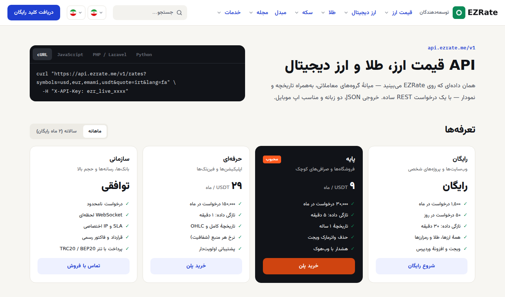

<div dir="rtl">

# API قیمت ارز، طلا و سکه — EZRate

[](https://ezrate.me/api/fa)
[](https://ezrate.me/auth/register/fa)
[English](README.en.md)

**EZRate** یک وب‌سرویس (REST API) برای قیمت لحظه‌ای بازار آزاد ایران است: **دلار، یورو، درهم، لیر و بیش از ۲۰ ارز دیگر، طلای ۱۸ و ۲۴ عیار، مثقال، انس جهانی، سکه امامی و بهار آزادی، تتر، بیت‌کوین و ارزهای دیجیتال**. خروجی JSON است و به تومان، ریال، دلار، تتر یا هر دارایی دیگری که بخواهید برمی‌گردد.

قیمت‌ها از دل معاملات واقعی (کانال‌های صرافی، بازارها و صرافی‌های رمزارز) جمع و میانه‌گیری می‌شوند. کنار هر نرخ تعداد منبع‌ها هم برمی‌گردد تا بدانید عدد چقدر قابل اتکاست.

> 🔑 **کلید رایگان:** در [ezrate.me](https://ezrate.me/auth/register/fa) ثبت‌نام کنید و از پنل کاربری › «کلیدهای API» کلید بسازید. ثبت‌نام و پلن رایگان هزینه‌ای ندارد.



## فهرست

- [شروع سریع](#شروع-سریع)
- [API قیمت دلار و ارزها](#api-قیمت-دلار-و-ارزها)
- [API قیمت طلا و سکه (وب‌سرویس طلا)](#api-قیمت-طلا-و-سکه-وبسرویس-طلا)
- [API تتر و ارز دیجیتال](#api-تتر-و-ارز-دیجیتال)
- [تبدیل ارز و نرخ متقاطع](#تبدیل-ارز-و-نرخ-متقاطع)
- [تاریخچه و نمودار](#تاریخچه-و-نمودار)
- [همهٔ مسیرها](#همهٔ-مسیرها)
- [نمونه‌کد: PHP، جاوااسکریپت، پایتون](#نمونهکد)
- [خطاها و محدودیت‌ها](#خطاها-و-محدودیتها)
- [ویجت و افزونهٔ وردپرس](#ویجت-و-افزونهٔ-وردپرس)

## شروع سریع

آدرس پایه: `https://api.ezrate.me/v1`. کلید را در هدر `X-API-Key` (یا `Authorization: Bearer`) بفرستید.

</div>

```bash
curl -H "X-API-Key: ezr_live_YOUR_KEY" \
  "https://api.ezrate.me/v1/rates?symbols=usd,g18,emami,usdt&lang=fa"
```

<div dir="rtl">

پاسخ (کوتاه‌شده):

</div>

```json
{
  "data": [
    { "symbol": "usd", "code": "USD", "name": "دلار آمریکا", "category": "fiat", "market": "tehran",
      "buy": 259150, "sell": 259350, "usd": null, "change_pct": 0.12,
      "sources": 13, "low_sources": false, "updated_at": "2026-10-13T21:35:00Z", "quote": "IRT" },
    { "symbol": "g18", "code": "G18", "name": "طلای ۱۸ عیار", "category": "gold",
      "buy": 25978000, "sell": 26038000, "change_pct": -0.21, "sources": 13, "quote": "IRT" },
    { "symbol": "usdt", "code": "USDT", "name": "تتر", "category": "crypto",
      "buy": 257300, "sell": 257600, "usd": "1.00046606", "change_pct": 0.37, "sources": 16, "quote": "IRT" }
  ],
  "meta": { "as_of": "2026-10-14T11:07:42Z", "freshness_sec": 1800, "quote": "IRT" }
}
```

<div dir="rtl">

| فیلد | توضیح |
|---|---|
| `buy` / `sell` | قیمت خرید و فروش به واحد `quote` (پیش‌فرض تومان) |
| `change_pct` | درصد تغییر ۲۴ ساعت |
| `usd` | قیمت دلاری (برای طلا و رمزارز) |
| `sources` / `low_sources` | تعداد منبع‌هایی که در قیمت حساب شده‌اند و هشدار کم‌بودن منبع |
| `meta.freshness_sec` | تازگی داده در پلن شما |

## API قیمت دلار و ارزها

قیمت دلار آزاد تهران، یورو، درهم امارات، لیر ترکیه، پوند، یوان و ارزهای دیگر:

</div>

```bash
curl -H "X-API-Key: $EZRATE_KEY" "https://api.ezrate.me/v1/rates?category=fiat&lang=fa"
curl -H "X-API-Key: $EZRATE_KEY" "https://api.ezrate.me/v1/rates/usd"      # دلار + قیمت آن در بازارهای دیگر
curl -H "X-API-Key: $EZRATE_KEY" "https://api.ezrate.me/v1/rates?symbols=usd&quote=IRR"   # به ریال
```

<div dir="rtl">

نمادهای پرکاربرد: `usd` `eur` `aed` `try` `gbp` `cny` `cad` `aud` `sar` `iqd` `afn` `rub` `jpy`. فهرست کامل با `GET /v1/assets?category=fiat`.

## API قیمت طلا و سکه (وب‌سرویس طلا)

طلای ۱۸، ۲۱، ۲۲ و ۲۴ عیار (گرم)، مثقال، انس جهانی و سکه‌ها (امامی، بهار آزادی، نیم، ربع، گرمی):

</div>

```bash
curl -H "X-API-Key: $EZRATE_KEY" "https://api.ezrate.me/v1/rates?category=gold"
curl -H "X-API-Key: $EZRATE_KEY" "https://api.ezrate.me/v1/rates?category=coin"
curl -H "X-API-Key: $EZRATE_KEY" "https://api.ezrate.me/v1/rates?symbols=g18,mesghal,ounce,emami,bahar"
```

<div dir="rtl">

نمادها: `g18` `g21` `g22` `g24` `mesghal` `ounce` · `emami` `bahar` `nim` `rob` `gerami` · فلزات: `silver` `copper`.

## API تتر و ارز دیجیتال

قیمت تومانی تتر و رمزارزها همراه با قیمت دلاری:

</div>

```bash
curl -H "X-API-Key: $EZRATE_KEY" "https://api.ezrate.me/v1/rates?symbols=usdt,btc,eth,ton,trx"
curl -H "X-API-Key: $EZRATE_KEY" "https://api.ezrate.me/v1/rates?category=crypto&quote=USDT"   # بر حسب تتر
```

<div dir="rtl">

## تبدیل ارز و نرخ متقاطع

`quote` واحد همهٔ قیمت‌هاست: `IRT` (تومان، پیش‌فرض)، `IRR` (ریال) یا نماد هر دارایی (`usd`، `usdt`، `eur`، `g18`…).

</div>

```bash
# ۱۰۰ دلار چند یورو؟
curl -H "X-API-Key: $EZRATE_KEY" "https://api.ezrate.me/v1/convert?from=usd&to=eur&amount=100"
# {"data":{"from":"usd","to":"eur","amount":100.0,"side":"sell","rate":0.89231034,"inverse_rate":1.12068633,"result":89.23103389,"as_of":"…"}}

# یک دلار برابر چند یورو، درهم و تومان است (قیمت میانگین)
curl -H "X-API-Key: $EZRATE_KEY" "https://api.ezrate.me/v1/cross?base=usd&symbols=eur,aed,irt"
```

<div dir="rtl">

## تاریخچه و نمودار

کندل‌های ساعتی یا روزانه (OHLC) برای رسم نمودار:

</div>

```bash
curl -H "X-API-Key: $EZRATE_KEY" "https://api.ezrate.me/v1/history/usd?interval=1d&from=2026-09-01&to=2026-10-01"
# {"data":[{"t":"2026-09-01T20:30:00Z","o":258550,"h":259550,"l":257950,"c":259050}, …], "meta":{…}}
```

<div dir="rtl">

## همهٔ مسیرها

| مسیر | کاربرد |
|---|---|
| `GET /v1/assets?category=fiat\|gold\|coin\|crypto` | فهرست دارایی‌ها و نمادها |
| `GET /v1/rates?symbols=&category=&quote=&lang=` | قیمت لحظه‌ای چند دارایی |
| `GET /v1/rates/{symbol}` | یک دارایی با قیمت همهٔ بازارها |
| `GET /v1/history/{symbol}?interval=1h\|1d&from=&to=` | تاریخچه (کندل) |
| `GET /v1/convert?from=&to=&amount=&side=buy\|sell\|mid` | تبدیل ارز |
| `GET /v1/cross?base=&symbols=` | نرخ متقاطع |
| `GET /v1/global?base=USD` | نرخ جهانی ارزها |
| `GET /v1/markets/{symbol}` | قیمت در بازارهای مختلف |
| `GET /v1/usage` | مصرف امروز و این ماه (از سهمیه کم نمی‌شود) |

مشخصات کامل در قالب OpenAPI: [`openapi.yaml`](openapi.yaml) (در Postman یا Swagger Editor باز کنید).

## نمونه‌کد

- [PHP](examples/php/rates.php)
- [JavaScript / Node.js](examples/javascript/rates.mjs)
- [Python](examples/python/rates.py)
- [cURL](examples/curl.sh)

کلید را در متغیر محیطی `EZRATE_KEY` بگذارید، نه داخل کد. کلید را هیچ‌وقت در کد سمت مرورگر یا اپ منتشرشده قرار ندهید. برای نمایش قیمت در سایت، از [ویجت‌ها](https://github.com/ezrate-me/ezrate-widgets) استفاده کنید که کلید نمی‌خواهند.

## خطاها و محدودیت‌ها

| کد | معنی |
|---|---|
| `401 invalid_api_key` | کلید ارسال نشده، نامعتبر یا باطل شده |
| `403 forbidden` | دامنه یا IP مجاز نیست (محدودیت دامنه/IP را در پنل تنظیم کرده‌اید) |
| `429 rate_limited` | سهمیهٔ روزانه یا ماهانه تمام شده؛ زمان بازشدن در `meta.reset_at` |

سهمیهٔ هر پلن، تازگی داده و عمق تاریخچه در [صفحهٔ API](https://ezrate.me/api/fa) و [پلن‌ها](https://ezrate.me/plans/fa) آمده است. پاسخ‌ها هدرهای محدودیت (rate-limit) دارند.

## ویجت و افزونهٔ وردپرس

- **[ویجت قیمت ارز و طلا برای سایت](https://github.com/ezrate-me/ezrate-widgets)**: یک خط کد، بدون کلید API، با نمودار و پنج زبان.
- **[افزونهٔ وردپرس EZRate](https://github.com/ezrate-me/ezrate-wordpress)**: تیکر، کارت، جدول و نمودار قیمت در وردپرس بدون کدنویسی.
- **[تابلوی قیمت صرافی](https://ezrate.me/services/exchange-board/fa)** برای تلویزیون مغازه و **[ربات کانال تلگرام](https://ezrate.me/services/telegram-bot/fa)**.

## لینک‌ها

- وب‌سایت: [ezrate.me](https://ezrate.me/fa) · [قیمت دلار](https://ezrate.me/usd/fa) · [قیمت طلا](https://ezrate.me/gold/fa) · [قیمت سکه](https://ezrate.me/coin/fa) · [قیمت تتر](https://ezrate.me/crypto/usdt/fa)
- مستندات API: [ezrate.me/api/fa](https://ezrate.me/api/fa)
- پشتیبانی: از پنل کاربری › تیکت، یا [Issues](../../issues) همین مخزن برای سوال‌های فنی

نمونه‌کدهای این مخزن با مجوز MIT منتشر شده‌اند. داده‌ها مطابق [شرایط استفادهٔ EZRate](https://ezrate.me/legal/terms/fa) ارائه می‌شوند.

</div>
